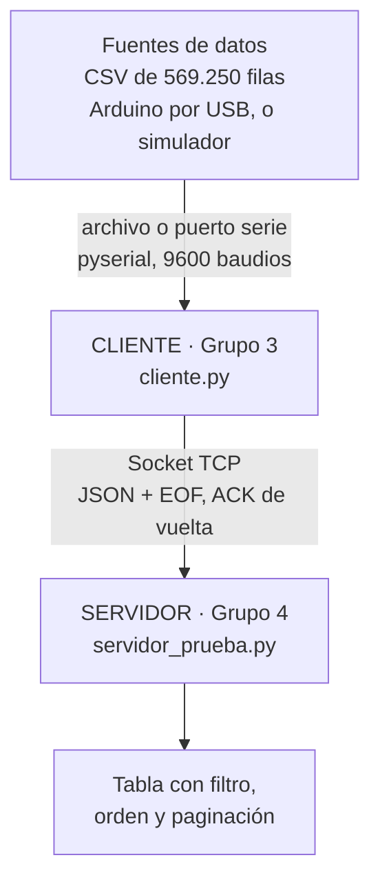
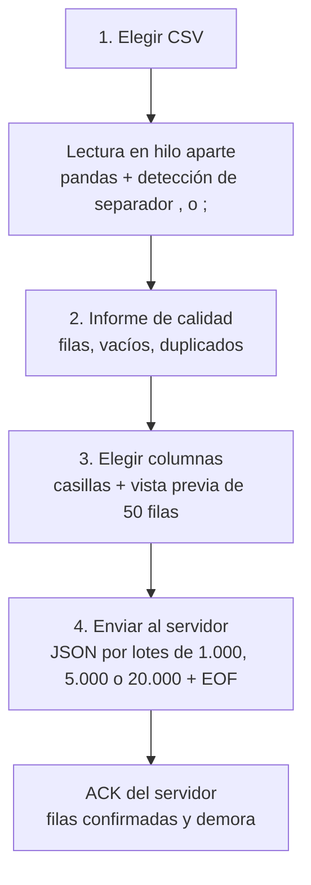
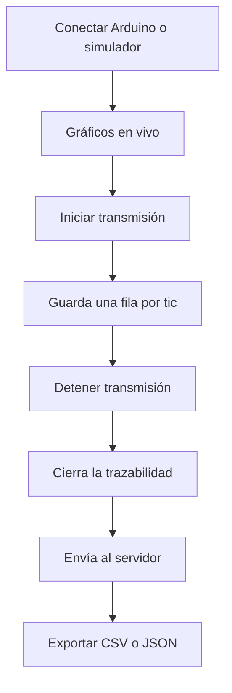
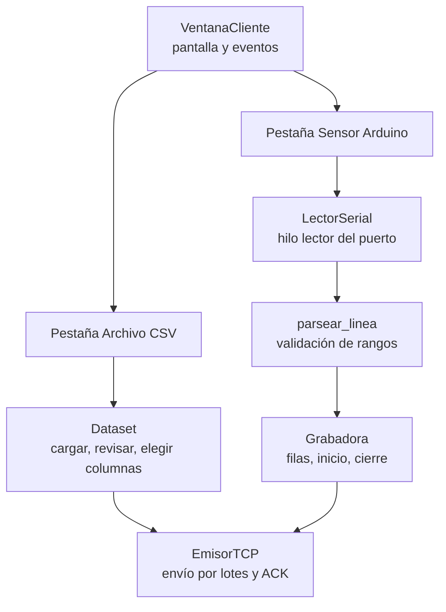
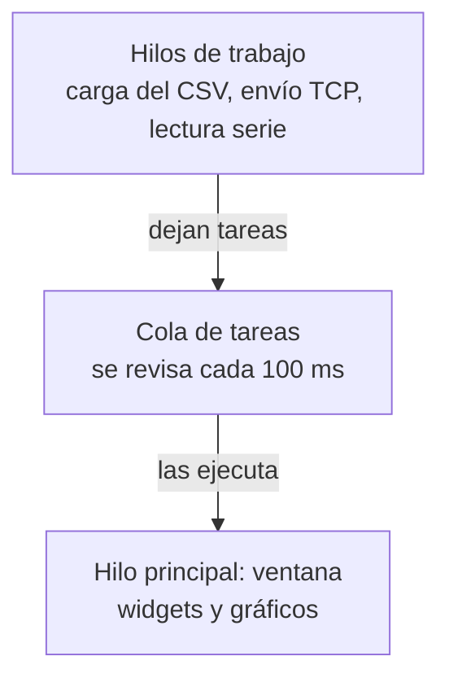

# MAESTRO · Aplicación Cliente-Servidor por sockets (Big Data)

Documento maestro del proyecto. Explica la aplicación completa y, con más detalle, la
**aplicación Cliente** (Grupo 3). La parte del **Servidor** (Grupo 4) se describe solo en lo
necesario para entender la conexión; ese equipo documentará la suya.

- **Autores del cliente (Grupo 3):** Escalante, Camilo · Jara, Danilo · López, Matías ·
  Ruiz, Fransheska · Soto, Marcelo.
- **Licencia:** solo educacional.
- **Última actualización:** 26-11-2026.

---

## 1. Qué es

Una aplicación en Python para **transferir datos por un socket TCP** desde un cliente a un
servidor, cada uno con su propia ventana (Tkinter). Hay dos fuentes de datos en el cliente:

1. **Un archivo CSV** grande (el dataset de caudales, 569.250 filas), del que el usuario elige
   qué columnas enviar.
2. **Un sensor Arduino** (temperatura, humedad y gas) leído por puerto serie, con gráficos
   en vivo y transmisión controlada por el usuario.

El servidor recibe, valida, y muestra los datos en una tabla con búsqueda, orden y paginación.

---

## 2. Visión general

### 2.1 Arquitectura



Hay **dos conexiones distintas** que no deben confundirse:

| Conexión | Entre | Tecnología | Responsable |
|---|---|---|---|
| Serie | Arduino → cliente | `pyserial` (USB, o `socket://` con el simulador) | Grupo 3 |
| TCP | Cliente → servidor | `socket`, JSON + `<EOF>` | Grupo 3 envía, Grupo 4 recibe |

### 2.2 Contrato de datos (acordado entre ambos grupos)

El cliente y el servidor se entienden por este contrato. **Cualquier cambio debe acordarse
con el otro grupo.**

| Aspecto | Acuerdo |
|---|---|
| Formato | Un arreglo JSON de objetos: `[{"col": valor, ...}, ...]` |
| Fin del envío | La marca de texto `<EOF>` justo después del `]`, y luego el cliente cierra su lado de escritura (`shutdown`) |
| Vacíos | Se envían como `null` |
| Codificación | ASCII puro (las tildes viajan escapadas como `\uXXXX`) |
| Respuesta | Una línea JSON: `{"ok": true, "filas": N, "detalle": "..."}` |
| Un envío = una conexión | El servidor reemplaza su tabla en cada conexión nueva |

### 2.3 Componentes

| Archivo | Rol | Responsable |
|---|---|---|
| `cliente.py` | Ventana del cliente, lectura de CSV, envío TCP, panel Arduino | Grupo 3 |
| `sensor_arduino.py` | Lógica del sensor: puerto serie, validación, grabación, exportación | Grupo 3 |
| `simulador_arduino.py` | Simulador de Arduino (ventana aparte, solo pruebas) | Grupo 3 |
| `servidor_prueba.py` | Servidor con dashboard | Grupo 4 |
| `scrip_arduino_sensor_v3.txt` | Código para la placa (1 línea por segundo) | Grupo 3 |
| `requirements.txt`, `requirements-dev.txt` | Dependencias para ejecutar y para desarrollar | Grupo 3 |
| `tests/` | Pruebas automáticas (116) | ambos |
| `docs/` | Informes y documentación detallada | ambos |

---

## 3. Cómo ejecutarla

**Requisitos:** Python 3.10 o superior (se probó con 3.14). Tkinter y `socket` vienen con
Python; el resto se instala con `pip`.

**Instalación** (una sola vez, desde la carpeta raíz del proyecto):

```bash
pip install -r requirements.txt          # para ejecutar: pandas y pyserial
pip install -r requirements-dev.txt      # para ejecutar y además correr las pruebas (agrega pytest)
```

| Paquete | Para qué | ¿Obligatorio? |
|---|---|---|
| `pandas` | Leer el CSV y armar los lotes | Sí |
| `pyserial` | Puerto serie del Arduino y conexión al simulador | Solo para la pestaña Arduino y el simulador |
| `pytest` | Pruebas automáticas | Solo para desarrollar |

La instalación desde cero se validó en un entorno virtual nuevo: con `requirements-dev.txt`
pasan las 116 pruebas (solo en Windows).

| Para… | Comando |
|---|---|
| Abrir el servidor | `python servidor_prueba.py` (luego pulsar el botón para iniciar la escucha) |
| Abrir el cliente | `python cliente.py` |
| Abrir el simulador de Arduino | `python simulador_arduino.py` |
| Correr las pruebas | `python -m pytest -q` |

Orden normal: **primero el servidor, después el cliente.** Con el simulador: servidor →
simulador (Encender) → cliente.

**Variables de entorno (opcionales):** `SERVIDOR_HOST` (por defecto `127.0.0.1`),
`SERVIDOR_PUERTO` (`12345`), `SIMULADOR_PUERTO` (`5577`). Los valores también se pueden
cambiar en la pantalla.

---

## 4. Aplicación Cliente (detalle)

La ventana tiene dos pestañas que comparten el mismo destino (IP y puerto del servidor):
**Archivo CSV** y **Sensor Arduino**.

### 4.1 Pestaña «Archivo CSV»



- **Carga:** `Dataset.cargar` detecta el separador (`,` o `;`), rechaza archivos con filas
  más largas que el encabezado, vacíos o con columnas repetidas, y muestra un mensaje claro.
- **Informe:** solo informa (filas, columnas, vacíos por columna, filas idénticas). **No
  modifica ni borra datos.**
- **Columnas:** una casilla por columna real del archivo. Nunca hay texto libre, así que no se
  puede pedir una columna que no existe.
- **Envío por lotes:** se arma un único arreglo JSON, pero se envía en trozos
  (`"[" + lote + "," + lote + … + "]<EOF>"`). Así no se tiene todo el texto en memoria y la
  barra avanza lote a lote.
- **Resultado:** el cliente compara las filas enviadas con las que confirma el servidor y
  muestra la **demora** y las filas por segundo.
- **Cancelar:** el botón corta el envío en menos de un par de segundos, también durante la
  conexión o la espera de la respuesta.

### 4.2 Pestaña «Sensor Arduino»



- **Conexión:** lista de puertos serie detectados, más la opción del simulador al final.
  Los gráficos aparecen solo al conectar.
- **Gráficos:** uno por magnitud, cada uno con su propia escala (nunca doble eje). Muestran
  valor actual, mín/máx, guías con escala y relleno suave.
- **Frecuencias:** 1 dato por segundo, 1 cada 2 s y 1 cada 3 s. El DHT11 entrega **como máximo
  1 dato por segundo**, por eso no se ofrecen frecuencias más rápidas.
- **Iniciar / Detener transmisión:** al iniciar se valida la red *antes* de capturar. Al
  detener se envían **todas** las filas en una sola conexión.
- **Trazabilidad:** el panel muestra fecha y hora de inicio, de cierre, duración, filas y
  frecuencia. Si se corta el cable en plena transmisión queda registrada como «Interrumpida»
  y no se envía. Además, cada fila lleva su propia `fecha_hora` con milisegundos.
- **Exportar:** los botones **CSV…** y **JSON…** guardan la última transmisión con las mismas
  cuatro columnas que viajan al servidor: `fecha_hora`, `temperatura`, `humedad`, `gas`.
- **Validación de lo que llega por el cable:** se descartan las líneas fuera de rango
  (temperatura −40 a 80, humedad 0 a 100, gas 0 a 1023), con `NaN`, cortadas o con
  `ERROR_LECTURA`. Una lectura de más de 6 s se considera caducada.

**¿Por qué se envía todo al detener y no fila a fila?** El servidor reemplaza su tabla en cada
conexión, corta cada conexión a los 600 s y solo muestra los datos al recibir `<EOF>`. Enviar al
detener evita las tres limitaciones sin cambiar el contrato. El costo: si la aplicación se
cierra mientras transmite, lo capturado se pierde.

### 4.3 Arquitectura del código



Dos carriles que convergen en `EmisorTCP`: el mismo código de red envía el CSV y la
transmisión del Arduino. `GraficoLinea` (gráficos) y `Espejo` (progreso compartido) son
ayudantes de la ventana, descritos en la tabla.

| Clase / función | Archivo | Qué hace |
|---|---|---|
| `VentanaCliente` | `cliente.py` | La ventana. No sabe leer CSV ni usar sockets: delega y solo muestra |
| `Dataset` | `cliente.py` | Carga, informe y selección de columnas. Sirve para cualquier CSV |
| `EmisorTCP` | `cliente.py` | Envío por lotes con cancelación y lectura del ACK |
| `GraficoLinea` | `cliente.py` | Minigráfico de líneas dibujado con `tk.Canvas` (sin librerías extra) |
| `Espejo` | `cliente.py` | Repite `configure()` en varios widgets (barra y estado en las dos pestañas) |
| `LectorSerial` | `sensor_arduino.py` | Hilo que lee el puerto, valida y guarda la última lectura |
| `Grabadora` | `sensor_arduino.py` | Acumula filas y registra inicio, cierre y duración |
| `exportar_csv` / `exportar_json` | `sensor_arduino.py` | Guardan lo capturado |

**Errores propios:** todos heredan de `ErrorCliente` (`ErrorArchivo`, `ErrorRed`,
`EnvioCancelado`), y la interfaz solo captura esa clase. `ErrorSensor` cubre el puerto serie.

### 4.4 Hilos

Tkinter no es seguro entre hilos: **solo el hilo principal toca los widgets.** Los hilos
(carga del CSV, envío TCP, lectura serie) dejan tareas en una cola, y la ventana las ejecuta
cada 100 ms. Por eso la pantalla no se congela con archivos grandes.



### 4.5 Errores contemplados

| Situación | Respuesta |
|---|---|
| CSV con separador distinto, filas largas o vacío | Mensaje claro; no se carga |
| IP o puerto inválidos | Se avisa antes de abrir el socket (y antes de capturar con el Arduino) |
| Servidor apagado | «No hay un servidor escuchando…»; se puede reintentar |
| Servidor que no lee o no responde | Se rinde a los 60 s sin avance |
| Cancelar el envío | Se corta y la pantalla queda lista |
| Falta `pyserial` | La tarjeta avisa cómo instalarlo |
| Puerto serie ocupado o inexistente | Mensaje claro; no queda conectado |
| Se desconecta el cable | Se desconecta solo y descarta lo capturado |
| Detener sin filas capturadas | Aviso; no se abre ninguna conexión |

### 4.6 Seguridad

Aplica aunque sea un trabajo de ramo.

| Riesgo | Medida |
|---|---|
| Entrada del usuario | IP y puerto validados; las columnas salen de la lista real del archivo |
| Datos que llegan por el cable | Validación de rango y descarte de líneas corruptas |
| Conexión colgada | Timeouts de conexión (3 s) y de respuesta (60 s) |
| Datos en los logs | No se registran filas; solo contadores y estados |
| IP y puerto fijos en el código | Campos en pantalla y variables de entorno |
| Simulador expuesto a la red | Escucha solo en `127.0.0.1` |
| CSV o `.env` subidos al repositorio | `.gitignore` los excluye |
| Tráfico sin cifrar | Aceptable en `127.0.0.1`; para red real convendría TLS |

> **Limitación conocida:** el contrato no incluye huella (hash) del contenido, así que el
> servidor no detecta una alteración en el camino. Es aceptable en `127.0.0.1`; en red real
> conviene agregar una huella `sha256` en el mensaje final.

### 4.7 Pruebas

116 pruebas automáticas (`python -m pytest -q`):

| Archivo | Pruebas | Cubre |
|---|---|---|
| `tests/test_cliente.py` | 45 | Carga de CSV, columnas, envío, cancelación, errores de red |
| `tests/test_servidor.py` | 32 | Recepción, validación, filtros, carga masiva |
| `tests/test_sensor.py` | 24 | Validación de líneas, lector serie, grabadora, trazabilidad, exportación |
| `tests/test_simulador.py` | 15 | Generador de datos, exportación, conexión real por `socket://`, recorrido completo |

---

## 5. Simulador de Arduino (solo pruebas)

Como la placa es de la universidad y no siempre está disponible, `simulador_arduino.py` abre
una ventana que **emite líneas idénticas a las del Arduino** (una por segundo) por un socket
local. La aplicación lo trata como un puerto más (`socket://127.0.0.1:5577`) y usa
**exactamente el mismo código de lectura** que con la placa.

- **Los datos son sintéticos:** modelan un DHT11 (enteros, con fallos ocasionales) y un MQ-2
  (precalentamiento y eventos de gas). Con la misma semilla la secuencia se repite.
- **Exporta** lo enviado en CSV y JSON. Esas exportaciones llevan `origen = simulado` y la
  semilla.
- **Importante:** las filas que el cliente envía al servidor **no** llevan la marca `origen`.
  Si el equipo del servidor analiza datos generados con el simulador, hay que avisarles que
  son simulados.

Detalle completo en [`docs/simulador_arduino.md`](docs/simulador_arduino.md).

---

## 6. Servidor (resumen para entender la conexión)

A cargo del Grupo 4 (`servidor_prueba.py`). Lo que importa para el cliente:

- Escucha en un socket y recibe **en un hilo aparte**, hasta que el cliente cierra su lado de
  escritura. Decodifica solo al final y exige la marca `<EOF>`.
- Valida que el JSON sea una lista de objetos y rechaza constantes inválidas
  (`NaN`, `Infinity`), columnas duplicadas y números fuera de rango.
- Límites por conexión: **512 MiB**, **60 s** sin avance y **600 s** en total (configurables
  con `SERVIDOR_MAX_BYTES`, `SERVIDOR_TIMEOUT` y `SERVIDOR_TIEMPO_TOTAL`).
- Muestra los datos en una tabla paginada (1.000 filas por página) con búsqueda de texto y
  ordenamiento por columna. **Reemplaza la tabla** en cada conexión.
- Responde con el ACK en JSON una vez aplicados los datos en su interfaz.

Para el detalle, ver [`docs/informe_servidor_grupo4.md`](docs/informe_servidor_grupo4.md) y
[`docs/pruebas_servidor_2026-10-27.md`](docs/pruebas_servidor_2026-10-27.md). La
documentación definitiva del servidor la elaborará el Grupo 4.

---

## 7. Decisiones de diseño

| Decisión | Por qué |
|---|---|
| Un solo arreglo JSON enviado por lotes | Evita tener todo el texto en memoria y deja avanzar la barra |
| `shutdown` de escritura + `<EOF>` | El servidor sabe cuándo terminó sin depender de un tamaño |
| Cola de tareas entre hilos y ventana | Tkinter solo es seguro en el hilo principal |
| Arduino enviado todo al detener | El servidor reemplaza la tabla y corta a los 600 s |
| Frecuencias de 1, 2 y 3 s | El DHT11 entrega 1 dato por segundo como máximo |
| `socket://` para el simulador | Mismo código que con la placa, sin drivers de puertos virtuales |
| Gráficos con `tk.Canvas` | Cero dependencias nuevas; cada magnitud con su escala |
| Estructura plana de archivos | Proyecto pequeño; las capas se separan por clase, no por carpeta |
| Cargar el CSV completo en memoria | 569.250 filas caben holgadamente y simplifica la selección |

---

## 8. Estado, límites y pendientes

**Validado:** funcionamiento en **Windows** (decisión del proyecto: no se valida en Linux), 116
pruebas automáticas y recorrido completo simulador → cliente → servidor.

**Pendiente:**

- **Probar con el Arduino real:** el script `scrip_arduino_sensor_v3.txt` no se ha compilado ni
  cargado en la placa. El simulador no valida el cableado ni el DHT11 o el MQ-2 reales.
- **Probar por red real** (LAN o hotspot): IP, puerto, tamaño de lote y demora para el informe.
- **Confirmar con el Grupo 4** el comportamiento del ACK (inmediato al recibir, o después de
  aceptar y mostrar los datos).
- **Marca de origen** en las filas que llegan al servidor, si se quiere distinguir datos
  simulados de reales.
- **Cifrado (TLS) y huella del contenido** si se pasa a una red real.

**Limitaciones conocidas:**

- Las lecturas del MQ-2 son valores relativos (0 a 1023), no ppm calibradas.
- Si la aplicación se cierra durante una transmisión Arduino, lo capturado se pierde.
- Los parámetros del simulador son supuestos razonables, no están calibrados con la placa.

---

## 9. Documentación relacionada

| Documento | Contenido |
|---|---|
| [`docs/informe_arquitectura.md`](docs/informe_arquitectura.md) | Informe de arquitectura del cliente (CSV y red) |
| [`docs/flujo_logico_arduino.md`](docs/flujo_logico_arduino.md) | Flujo lógico con el Arduino: secuencias, estados, hilos |
| [`docs/simulador_arduino.md`](docs/simulador_arduino.md) | Simulador: modelo de datos y exportación |
| [`docs/informe_servidor_grupo4.md`](docs/informe_servidor_grupo4.md) | Revisión del servidor del Grupo 4 |
| [`docs/pruebas_servidor_2026-10-27.md`](docs/pruebas_servidor_2026-10-27.md) | Pruebas del servidor del 27-10 |
| `contexto.txt` e `instrucciones.txt` | Propuesta de integración y enunciado de la evaluación |
