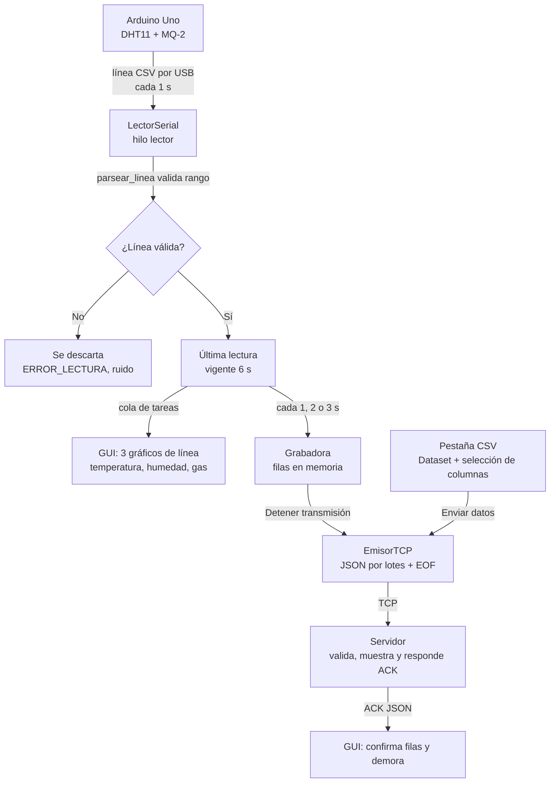
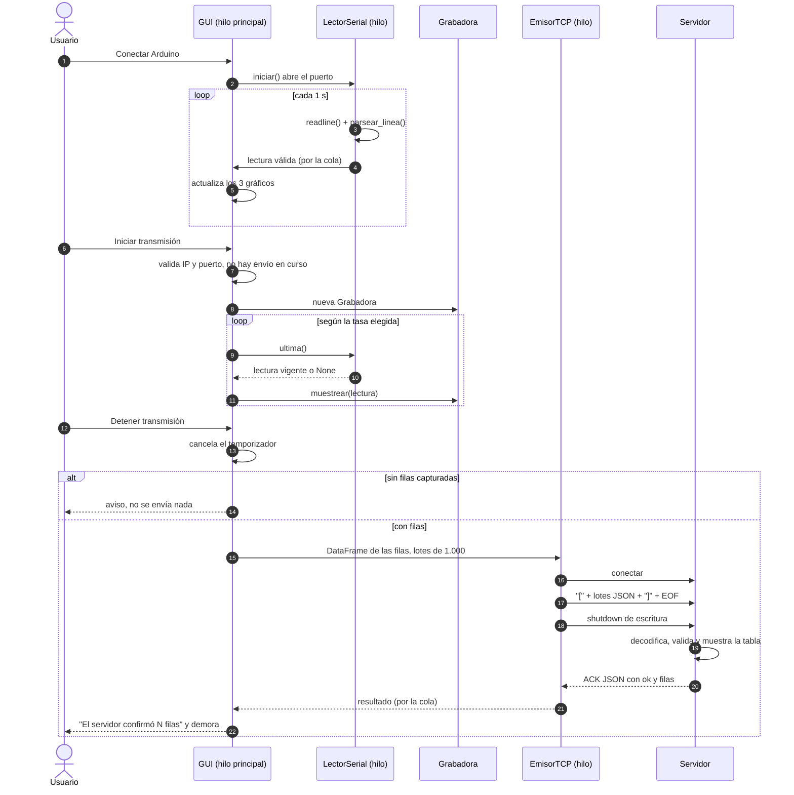
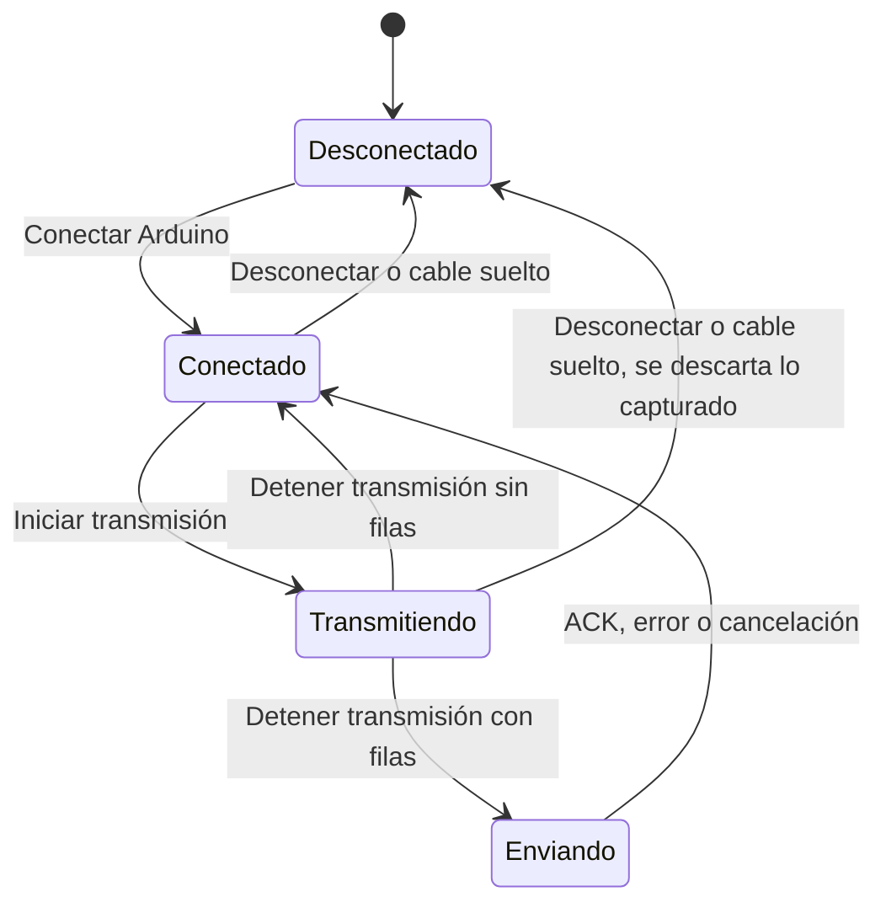
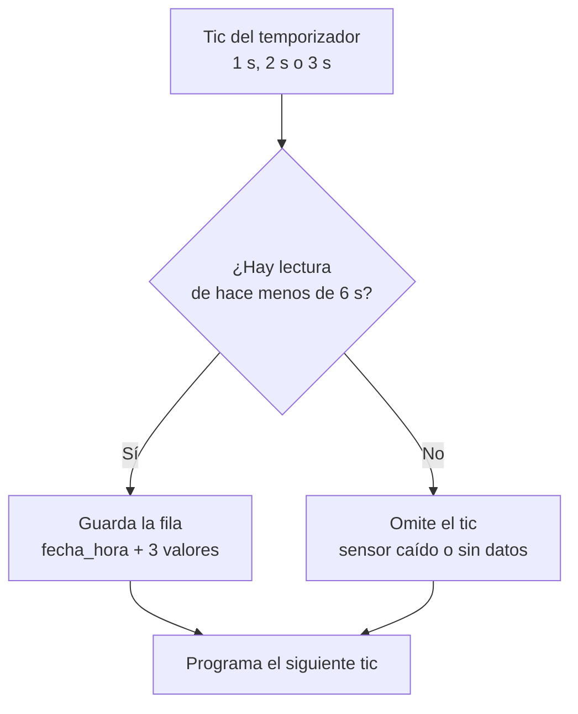
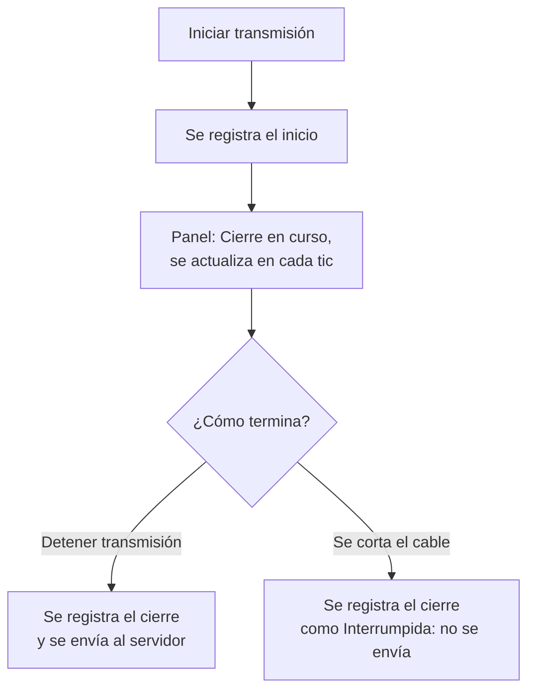
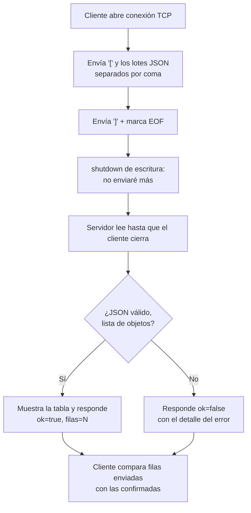
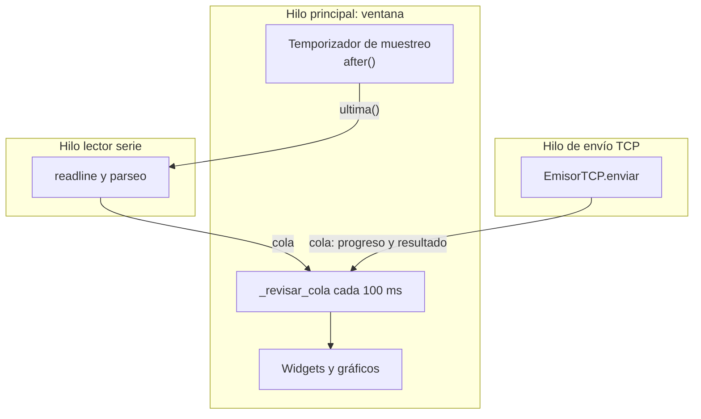

# Flujo lógico de la aplicación cliente (CSV + Arduino)

Rama `rama-arduino`. Este documento describe cómo viaja un dato desde el sensor
hasta la tabla del servidor, y por qué se tomaron las decisiones principales.

## 1. Visión general

La aplicación cliente tiene **dos pestañas** que comparten un mismo destino: el servidor TCP.
Hay **dos conexiones distintas** y no deben confundirse:

| Conexión | Entre | Tecnología | Quién la maneja |
|---|---|---|---|
| Serie (USB) | Arduino → aplicación | `pyserial`, 9600 baudios | `LectorSerial` (`sensor_arduino.py`) |
| TCP | Aplicación → servidor | `socket`, JSON + `<EOF>` | `EmisorTCP` (`cliente.py`) |



## 2. Formato de los datos

El Arduino envía una línea por lectura. La aplicación la convierte en una fila:

```text
24.5,60.0,312        →   fecha_hora            temperatura  humedad  gas
                         2026-11-16 17:02:31.250   24.5        60.0     312.0
```

`parsear_linea` rechaza cualquier cosa fuera de rango, porque lo que llega por el cable
no es de confianza (ruido, línea cortada al conectar, `NaN`):

| Campo | Rango aceptado |
|---|---|
| temperatura | −40 a 80 °C |
| humedad | 0 a 100 % |
| gas | 0 a 1023 (valor relativo del MQ-2, no son ppm) |

## 3. Secuencia completa de una transmisión



## 4. Estados de la pestaña Arduino



Qué ocurre en cada estado:

- **Desconectado:** solo se ve la fila de conexión. Los gráficos aparecen al conectar.
- **Conectado:** los gráficos se actualizan con cada línea válida. Todavía no se guarda nada.
- **Transmitiendo:** además de graficar, se guarda una fila por tic de la tasa elegida.
  Mientras tanto, el envío del CSV queda deshabilitado para no mezclar ambos flujos.
- **Enviando:** hilo aparte; la ventana sigue respondiendo y se puede **cancelar**.

## 5. Las tres frecuencias de captura

El **DHT11 entrega un dato nuevo por segundo como máximo (1 Hz)**. Por eso la frecuencia más
rápida posible es 1 dato por segundo, y las otras dos son más lentas. El Arduino (script v3)
envía una línea por segundo, y la aplicación decide cada cuánto **guarda** una fila.



| Opción | Intervalo | Filas por minuto |
|---|---|---|
| 1 dato por segundo | 1 s | 60 |
| 1 dato cada 2 segundos | 2 s | 30 |
| 1 dato cada 3 segundos | 3 s | 20 |

> **Historial:** las versiones anteriores ofrecían 2 y 5 datos por segundo, que el DHT11
> no puede entregar: se repetían valores. Se retiraron y el script v3 envía a 1 Hz.

## 5.1 Trazabilidad de la transmisión

Al pulsar **Iniciar transmisión** la `Grabadora` registra la fecha y hora de inicio, y al
pulsar **Detener transmisión** (o al cortarse el cable) registra el cierre. El panel
"Trazabilidad de la transmisión" de la pestaña Arduino lo muestra:

```text
Inicio: 23/11/2026 15:28:35   ·   Cierre: 23/11/2026 15:31:02
Duración: 2 min 27 s   ·   147 filas   ·   Frecuencia: 1 dato por segundo
```



Además, **cada fila** lleva su propia `fecha_hora` (con milisegundos), así que el servidor
recibe la trazabilidad fila por fila y no solo el inicio y el cierre.

## 5.2 Exportar lo capturado (CSV y JSON)

En el panel de trazabilidad, los botones **CSV…** y **JSON…** guardan las filas de la última
transmisión, es decir, las mismas que se envían al servidor. Se habilitan al detener la
transmisión (o si se cortó el cable) y se deshabilitan mientras se transmite.

Ambos formatos llevan **solo cuatro campos**: `fecha_hora`, `temperatura`, `humedad`, `gas`.

```text
CSV                                          JSON (igual que viaja por el socket)
fecha_hora,temperatura,humedad,gas           [ { "fecha_hora": "2026-11-23 15:00:00.123",
2026-11-23 15:00:00.123,23.0,55.0,134.0        "temperatura": 23.0, "humedad": 55.0, "gas": 134.0 } ]
```

El JSON exportado es idéntico a lo que recibe el servidor (hay una prueba que lo comprueba).
Sirve para comparar cómo cambia el tipo de dato: en CSV todo es texto y el lector decide el
tipo; en JSON los números llegan ya como números.

## 6. Protocolo hacia el servidor (sin cambios)

El servidor es del Grupo 4 y no se modificó. La transmisión Arduino reutiliza el mismo
contrato que el envío de CSV:



### ¿Por qué se envía todo al detener y no fila a fila?

El nombre "Iniciar transmisión" sugiere un envío en vivo, pero el envío ocurre al detener.
Razones, todas del lado del servidor actual:

1. **Reemplaza su tabla en cada conexión.** Enviar por tandas dejaría solo la última tanda.
2. **Corta cada conexión a los 600 s** (`SERVIDOR_TIEMPO_TOTAL`). Una sola conexión larga
   fallaría en grabaciones largas.
3. **Solo muestra los datos al recibir `<EOF>`.** El envío en vivo no se vería antes del final.

Enviar al detener evita las tres sin tocar el servidor. El costo: si la aplicación se cierra
mientras se transmite, lo capturado se pierde. Para verlo en vivo en el servidor habría que
acordar con el Grupo 4 que **acumule** filas en vez de reemplazarlas.

## 7. Hilos y comunicación con la ventana

Tkinter no es seguro entre hilos: **solo el hilo principal toca los widgets**. Los hilos
dejan tareas en una cola y la ventana las ejecuta cada 100 ms (`_revisar_cola`).



## 8. Errores contemplados

| Situación | Respuesta de la aplicación |
|---|---|
| Falta `pyserial` | La tarjeta avisa "Falta pyserial: ejecute pip install pyserial" |
| No hay puertos | "No se detectó ningún Arduino." |
| Puerto ocupado o inexistente | Mensaje claro; no queda conectado |
| Se desconecta el cable | Se desconecta solo y descarta lo capturado |
| Línea corrupta o `ERROR_LECTURA` | Se ignora; no entra a gráficos ni a la tabla |
| IP o puerto inválidos | Se avisa **antes** de empezar a capturar |
| Detener sin filas | Aviso; no se abre conexión |
| Servidor apagado | "No hay un servidor escuchando…"; se puede reintentar |
| Cancelar el envío | Se corta y la pantalla queda lista de nuevo |

## 9. Archivos y pruebas

| Archivo | Rol |
|---|---|
| `sensor_arduino.py` | Lógica del sensor sin GUI: parseo, lector serie, grabadora, tasas |
| `cliente.py` | Ventana con pestañas, gráficos (`GraficoLinea`) y `EmisorTCP` |
| `scrip_arduino_sensor_v3.txt` | Código para el Arduino: 1 línea por segundo (límite del DHT11) |
| `tests/test_sensor.py` | 22 pruebas con un puerto serie simulado, sin hardware |

Seguridad aplicada: validación de rango de todo lo que llega por el cable, límite de
antigüedad de lectura, y sin secretos ni datos sensibles en pantalla ni logs.

**Pendiente de validar:** prueba con el Arduino real y el MQ-2 conectado, y ejecución
en Linux (el repositorio se valida solo en Windows por decisión del equipo).
