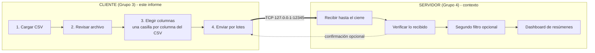
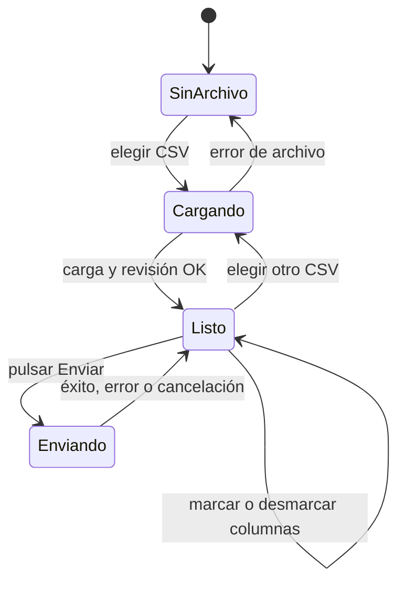
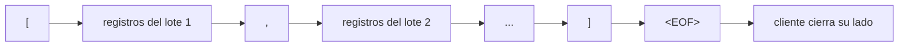
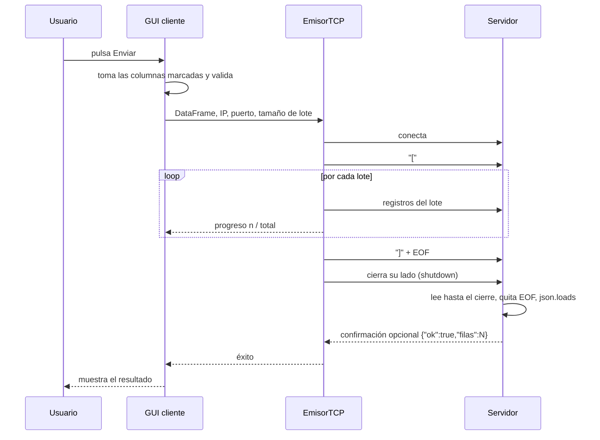
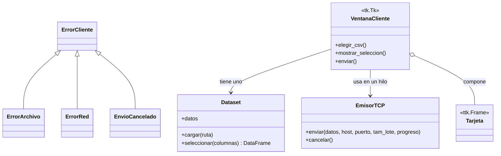
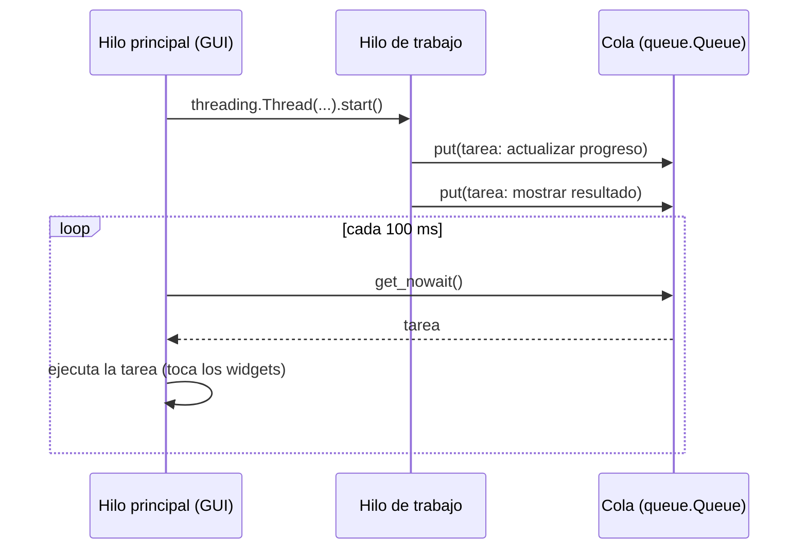
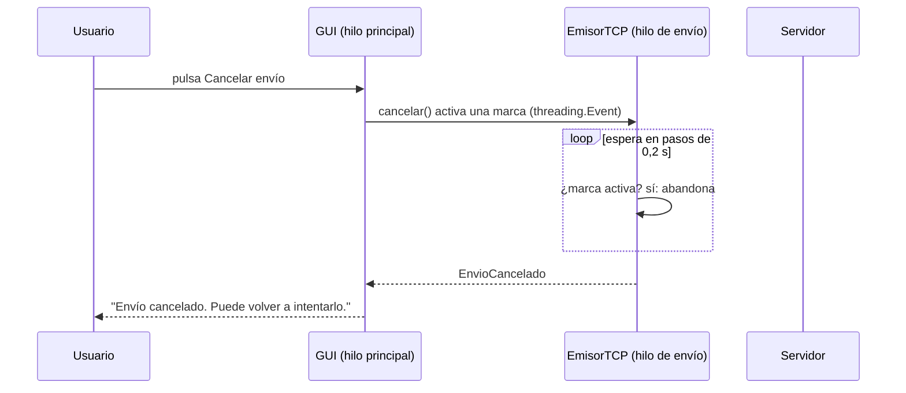

# Informe de arquitectura — Cliente (Grupo 3)

> **Proyecto:** envío de datos masivos por sockets (dataset de ejemplo: CAMELS-CL, flujos de aguas naturales)
> **Alcance:** la parte **cliente**. El servidor (Grupo 4) aparece solo como contexto, más un mini servidor de prueba nuestro.
> **Estado:** borrador vivo, se actualiza a medida que se toman decisiones.
>
> **Para ver bien los diagramas (Mermaid):** se recomienda abrir este documento con MarkText, que los muestra sin configuración extra. Descarga: https://github.com/marktext/marktext#download-and-installation

---

## 1. Resumen

Una aplicación de escritorio en Python que **carga un CSV cualquiera, lo revisa, deja elegir qué columnas enviar (casillas) y lo envía por un socket TCP al servidor en lotes**. El servidor verifica lo recibido, permite un segundo filtro y muestra un dashboard.

| Aspecto | Decisión |
|---|---|
| Dataset de ejemplo | `CAMELS_CL_caudales_2015_2019_569250.csv` (569.250 filas, 8 columnas, 62 MB) |
| Escalabilidad | La app **no conoce** las columnas de antemano: se adapta a cualquier CSV |
| Interfaz | **Tkinter** (`ttk`, tema `clam` personalizado), sobria pero cuidada |
| Transporte | TCP con `socket` de la biblioteca estándar |
| Contrato | El del demo del Grupo 4: arreglo JSON + `<EOF>`, puerto 12345 |
| Filosofía | KISS y comentarios pedagógicos (se harán consultas sobre el código) |
| Rúbrica | POO: clases, encapsulación y herencia |

## 2. Visión general (contexto)



**Por qué dos aplicaciones separadas:** simula un sistema distribuido real. La misma conexión sirve hoy en `127.0.0.1` y mañana entre dos máquinas o una VM: solo cambian la IP y el puerto, que se escriben en la pantalla.

## 3. Flujo de la aplicación cliente



| Etapa | Qué ve el usuario | Qué hace el código |
|---|---|---|
| Sin archivo | Solo el botón "Elegir CSV". El panel de columnas muestra un aviso y **no hay casillas** | Espera |
| Cargando | Barra de progreso | Lee y revisa el CSV en un hilo aparte, para no congelar la ventana |
| Listo | Informe de calidad, **una casilla por columna del CSV** y vista previa de 50 filas | Actualiza la vista previa cada vez que se marca o desmarca una casilla |
| Enviando | Barra de progreso por lote y el botón **Cancelar envío** (solo activo en esta etapa) | Envía lote a lote por el socket, revisando si el usuario canceló |
| Resultado | Mensaje de éxito o de error | Muestra la confirmación del servidor, si la hay |

Al cargar **otro** CSV, los controles anteriores se destruyen y se crean los del nuevo archivo.

## 4. Revisión del archivo (prechequeo)

Se muestra en la GUI al cargar. Es **genérica**, no depende de columnas concretas:

- Filas y columnas.
- **Vacíos** por columna.
- **Filas idénticas repetidas**.

> **Regla:** la revisión informa, **no modifica ni borra** datos.

## 5. Columnas a enviar (casillas)

El único "filtro" del cliente es **qué columnas se envían**. Al cargar el CSV aparece **una casilla por cada columna** que traiga el archivo (todas marcadas por defecto, libertad total):

- Al marcar o desmarcar una casilla, la **vista previa de 50 filas se actualiza sola** y muestra solo las columnas elegidas.
- Botones **Marcar todas** y **Desmarcar todas** para CSV con muchas columnas (la lista tiene scroll).
- Un contador indica cuántas columnas hay elegidas y cuántas filas se enviarán.
- Se exige que quede **al menos una** columna: si no, se avisa y el botón de envío no hace nada.
- Se envían **todas las filas**. Los filtros por rango, fecha o valor se retiraron a propósito: no son necesarios por ahora y el servidor ya tiene su propio filtro de vista.

**Por qué así (escalabilidad):** la pantalla no conoce las columnas de antemano. Si mañana se carga otro CSV, por ejemplo `pais, ventas, dia`, las casillas se rearman solas sin tocar el código. Esto se probó con un CSV distinto.

## 6. Contrato de red (el del demo del Grupo 4)

### 6.1 Qué cambió y por qué

| | Propuesta anterior (B) | **Contrato actual (demo)** |
|---|---|---|
| Formato | `[4 bytes de largo][JSON]` por mensaje | Un arreglo JSON de registros + `<EOF>` |
| Confirmaciones | ACK por lote + `sha256` | Ninguna obligatoria |
| Complejidad para el Grupo 4 | Media: leer el largo, validar, responder | **Mínima**: leer hasta el cierre y `json.loads` |
| Integridad | Fuerte | Básica: la marca `<EOF>` y un JSON válido |

Se eligió el contrato del demo porque **es el que el Grupo 4 ya tiene funcionando** y el proyecto exige KISS. El envío por lotes se mantiene **en el lado del cliente**.

### 6.2 Cómo viaja



El cliente arma **un solo arreglo JSON**, pero lo manda en trozos: `[` + lote 1 + `,` + lote 2 + … + `]` + `<EOF>`. Así nunca tiene todo el texto en memoria y la barra de progreso avanza lote a lote. Para el servidor es **idéntico** a recibir el JSON completo.

### 6.3 Secuencia



### 6.4 Detalles que hacen que funcione bien

| Detalle | Por qué |
|---|---|
| El cliente hace `shutdown(SHUT_WR)` al terminar | El servidor del demo lee hasta que el cliente cierra; sin esto se quedaría esperando |
| `json.dumps` escapa las tildes (`ó`) | El texto viaja en ASCII puro: ningún carácter se parte entre dos `recv()` |
| Los vacíos viajan como `null` | JSON no admite `NaN` |
| Los decimales viajan exactos | Se probó: `467.556221617695` llega igual. `to_json` de pandas lo redondeaba a 10 decimales |
| La confirmación del servidor es **opcional** | Si el servidor no responde, el cliente muestra "enviadas, sin confirmación" |

### 6.5 Tamaño del lote

| Opción | Filas por lote | Lotes (569.250 filas) |
|---|---|---|
| Pequeño | 1.000 | 570 |
| **Medio (por defecto)** | 5.000 | 114 |
| Grande | 20.000 | 29 |

El archivo completo viaja como ~**119 MB** de texto (el JSON repite los nombres de columna en cada registro; el CSV pesa 62 MB). Es normal para este formato.

### 6.6 Qué necesita saber el Grupo 4 (dos recomendaciones al demo)

1. **Decodificar después de unir los bytes.** En el demo, `conn.recv(1048576).decode('utf-8')` se hace por trozo; si una tilde queda partida entre dos trozos, falla. Con nuestro cliente no ocurre (viaja en ASCII), pero con otros clientes sí podría. Solución: guardar bytes y hacer `b"".join(fragmentos).decode("utf-8")` al final.
2. **Responder una línea JSON al terminar** (opcional): `{"ok": true, "filas": 569250}`. Así el cliente puede mostrar "el servidor confirmó la recepción". Si no responden, todo funciona igual.

`servidor_prueba.py` aplica ambas.

## 7. Arquitectura de código del cliente

### 7.1 Estructura de carpetas (plana, a propósito)

```text
bigdata_evaluacion2/
├── cliente.py            # TODO el cliente: lógica + GUI
├── servidor_prueba.py    # mini servidor con botón Iniciar/Detener escucha, SOLO para comprobar que los datos llegan
├── tests/test_cliente.py # 30 pruebas automáticas
├── docs/informe_arquitectura.md
└── (tu CSV)              # no se sube a git
```

**Por qué plana y sin MVC:** son pocas responsabilidades y un solo archivo se lee de arriba hacia abajo. Se separa por **clases**, no por carpetas. Si el proyecto creciera, cada clase puede pasar a su propio archivo sin cambiar su código.

### 7.2 Clases y relaciones



**Cómo se cumple la rúbrica de POO**

| Concepto | Dónde se ve |
|---|---|
| Clases | Una por responsabilidad: datos (`Dataset`), red (`EmisorTCP`), pantalla (`VentanaCliente`) |
| Encapsulación | `Dataset` guarda el DataFrame y el informe y los expone solo mediante `cargar()` y `seleccionar()`. `EmisorTCP` esconde el socket: la GUI solo llama a `enviar()` |
| Herencia | `VentanaCliente` hereda de `tk.Tk`, `Tarjeta` de `ttk.Frame`, y `ErrorArchivo` y `ErrorRed` de `ErrorCliente` |
| Composición | `VentanaCliente` tiene un `Dataset` y se compone de `Tarjeta`s |

### 7.3 Hilos y Tkinter

Cargar 62 MB o enviar 114 lotes toma segundos. Si ocurriera en el hilo principal, la ventana se congelaría.



**Por qué una cola:** Tkinter no es seguro entre hilos; solo el hilo principal puede tocar los widgets. El hilo de trabajo deja tareas (funciones) en la cola y la ventana las ejecuta con `after(100, ...)`.

### 7.4 Cancelar el envío

Si el servidor no está escuchando, no responde o está colgado, el cliente no debe quedar esperando sin poder hacer nada. El botón **Cancelar envío** (rojo, activo solo mientras se envía) interrumpe la operación en cualquier punto: conectando, enviando un lote o esperando la confirmación.



**Por qué esperar en pasos cortos y no cortar el socket:** se probó cerrar el socket desde otro hilo (`shutdown`), pero **en Windows eso no despierta** a un `send` o `recv` que ya está esperando. El hilo se quedaba dormido hasta 60 s. En cambio, si el propio hilo de envío espera en pasos de 0,2 s y revisa la marca entre uno y otro, la cancelación funciona igual en todos los sistemas y responde en menos de 1 s.

**Efectos secundarios útiles:**

- Al conectar se reintenta durante 3 s en pasos cortos: si el servidor se inicia en ese intervalo, el cliente se conecta igual.
- Una cancelación **nunca se confunde con un éxito**: si se cancela mientras se espera la respuesta, el resultado es "cancelado", no "enviadas sin confirmación".

> **Limitación:** si se cancela a mitad del envío, el servidor ya recibió datos parciales (sin `]` ni `<EOF>`). El servidor de prueba lo detecta y lo informa ("Falta la marca <EOF>"). El servidor del demo del Grupo 4 intentaría `json.loads` sobre un texto incompleto y mostraría su ventana de error: conviene avisarles que es el comportamiento esperado al cancelar.

### 7.5 Decisión: cargar todo en memoria

El CSV completo se carga en un DataFrame (carga medida: ~2 s) y el envío corta ese DataFrame en lotes con `iloc`. **Por qué:** es lo más simple y rápido para previsualizar y enviar. Si el archivo no cupiera en RAM, habría que leer con `chunksize` (mejora futura).

### 7.6 Comprobaciones para que el flujo no se rompa

| Momento | Qué se comprueba | Si falla |
|---|---|---|
| Al cargar | Se puede leer, tiene filas, no hay columnas repetidas | `ErrorArchivo` con el motivo |
| Al enviar | Al menos una columna | Mensaje en pantalla |
| Al enviar | Hay al menos una columna marcada; IP y puerto válidos | Mensaje; no se abre el socket |
| Al serializar | `allow_nan=False`; los vacíos van como `null` | Se detectaría un `NaN` suelto |
| Durante el envío | Conexión rechazada, timeouts y cortes | `ErrorRed` con un mensaje claro |
| Durante el envío | El usuario pulsa **Cancelar envío** | `EnvioCancelado`: se corta en menos de 1 s y la pantalla queda lista para reintentar |
| Al final | Confirmación del servidor, si la hay: debe coincidir el número de filas | Se muestra la discrepancia |

## 8. Seguridad

Aplica aunque sea un trabajo de ramo.

| Riesgo | Medida |
|---|---|
| Servidor recibe una cantidad ilimitada de datos | El servidor de prueba corta en 512 MiB. **Recomendado también para el servidor oficial** |
| JSON mal formado | `try/except` al decodificar (en el servidor de prueba) |
| Conexión colgada | Timeouts de conexión (3 s) y de respuesta (60 s) |
| IP y puerto fijos en el código | Campos en la pantalla, con valores iniciales desde las variables de entorno `SERVIDOR_HOST` y `SERVIDOR_PUERTO` |
| Entrada del usuario | IP y puerto validados antes de abrir el socket; las columnas elegidas salen siempre de la lista real del CSV (no se escribe texto libre) |
| Datos en los logs | No se registran filas; solo contadores y estados |
| Tráfico sin cifrar | Aceptable en `127.0.0.1`; para red real, usar TLS (`ssl`) |
| Subir el CSV o `.env` al repositorio | `.gitignore` excluye `*.csv` y `.env` |

> **Limitación conocida del contrato del demo:** sin ACK ni huella, el servidor solo puede comprobar que llegó `<EOF>` y que el JSON es válido. No detecta una alteración en el camino. Es aceptable en `127.0.0.1`; para una red real convendría volver a una huella `sha256` en el mensaje final.

## 9. Pruebas y verificación

`servidor_prueba.py` se escribió **sin importar `cliente.py`**, como lo haría otro grupo. Si los dos programas se entienden, el contrato está bien definido.

| Qué | Pruebas (30 en total, todas pasan) |
|---|---|
| Carga e informe | Cualquier CSV conserva sus columnas; conteo de vacíos y filas repetidas; archivos vacíos, sin filas o con columnas repetidas; archivo inexistente |
| Informe | Conteo de vacíos y de filas repetidas |
| Selección de columnas | Devuelve solo las elegidas; sin columnas se rechaza antes de enviar; en el envío solo viajan las columnas elegidas |
| Envío | Por lotes con vacíos y tildes; **decimales exactos**; envío cortado detectado; servidor apagado con error claro; sin filas |
| Compatibilidad | Reproduce la recepción del demo del Grupo 4 (que no responde nada): el cliente termina bien |
| Extremo a extremo | Los **569.250 registros reales** enviados y confirmados |
| Ventana del cliente | Una casilla por columna; desmarcar actualiza selección y vista previa; marcar/desmarcar todas; sin columnas no se envía; cargar otro CSV rearma las casillas |
| Cancelar el envío | Cancela mientras conecta; con un servidor que acepta pero no responde (envío chico: espera la respuesta; envío grande: se traba enviando); nunca se confunde con éxito; desde la ventana deja los botones listos para reintentar |
| Servidor de prueba (ventana) | Iniciar y detener la escucha, reiniciar, **puerto ocupado explicado en pantalla sin cerrar el programa**, y un envío cuyo resultado queda en el registro |

Prueba de humo de la GUI (sin intervención manual): al inicio no hay casillas y "Enviar" está bloqueado; tras cargar (~2 s) aparecen las 8 casillas con una vista previa de 50 filas; al desmarcar 2 columnas el contador y la tabla pasan a 6; envío de 569.250 filas con 6 columnas y confirmación del servidor; y un segundo CSV distinto rearma la pantalla.

> El CSV real no tiene vacíos ni filas repetidas; esos casos se cubren con CSV pequeños de prueba.

### Cómo ejecutar

Los dos programas se ejecutan **desde la carpeta raíz del proyecto** (la que contiene `cliente.py` y `servidor_prueba.py`), con **dos ventanas o pestañas de terminal abiertas en esa carpeta**, una para cada programa.

**1. Abrir la terminal en la carpeta raíz.** Cualquiera de estas formas sirve:

- En el Explorador de archivos, entrar a la carpeta del proyecto, escribir `cmd` o `powershell` en la barra de direcciones y pulsar Enter.
- O abrir CMD o PowerShell y escribir `cd` con la ruta del proyecto, por ejemplo: `cd C:\lab\bigdata_evaluacion2`.

**2. Instalar lo necesario (una sola vez)**, en el Python del equipo. `pytest` solo hace falta para correr las pruebas:

```powershell
pip install pandas pytest
```

**3. Ejecutar cada programa en su propia ventana o pestaña**, ambas abiertas en la carpeta raíz:

| Ventana o pestaña | Comando | Qué hacer después |
|---|---|---|
| 1 · Servidor de prueba | `python servidor_prueba.py` | Se abre su ventana: pulsar **Iniciar escucha** |
| 2 · Cliente | `python cliente.py` | Elegir el CSV, marcar las columnas y pulsar **Enviar datos** |

> **Orden:** primero el servidor (con la escucha iniciada) y después el cliente. Cada comando abre una ventana gráfica y deja la terminal ocupada mientras el programa esté abierto; por eso se necesita **una terminal por programa**. Para cerrar un programa, se cierra su ventana.

**Pruebas automáticas** (en cualquier terminal abierta en la carpeta raíz):

```powershell
python -m pytest -q
```

Para otra máquina o VM: escribir su IP en el campo "IP" de la pantalla.

> **Si el servidor dice "el puerto ya está en uso":** hay otra copia abierta (la del Grupo 4 o una ventana anterior del servidor de prueba). Cierre la otra o use "Detener escucha" en ella; los dos servidores no pueden compartir el puerto 12345.

## 10. Registro de decisiones

| # | Decisión | Motivo |
|---|---|---|
| 1 | Solo se desarrolla el cliente | Reparto de responsabilidades entre grupos |
| 2 | **Tkinter** (cambia respecto a PyQt) | Más fácil de entender y sin dependencias extra; se cuida el aspecto con `ttk` |
| 3 | **Contrato del demo** (arreglo JSON + `<EOF>`) en lugar de la alternativa B | El Grupo 4 ya lo tiene funcionando; más simple de integrar |
| 4 | El envío por lotes se mantiene en el cliente | Cumple la idea de "big data" y da progreso |
| 5 | Confirmación del servidor opcional | Compatible con el demo y útil cuando existe |
| 6 | Casillas de columnas generadas según el CSV; **sin filtros por rango ni por valor** | Escalabilidad (sirve para cualquier CSV) y simplicidad: el servidor ya filtra la vista |
| 7 | Libertad total para elegir columnas (mínimo una) | Pedido del equipo; se previene la rotura con comprobaciones previas |
| 8 | La revisión solo informa | Excluir registros queda como mejora futura |
| 9 | Vista previa de 50 filas | Suficiente para entender las columnas |
| 10 | Estructura plana, sin MVC, POO por clases | Simplicidad |
| 11 | Mini servidor de prueba propio | Asegurar desde el cliente que los datos llegan |
| 12 | **Sin `.venv`**: se usa el Python del equipo con `pandas` (y `pytest` para las pruebas); `*.csv` en `.gitignore` | La demo es local y no se traslada: la carpeta queda con lo mínimo y sin subir 62 MB |
| 13 | Botón **Cancelar envío** con espera en pasos de 0,2 s | Poder abortar si el servidor no está o no responde; cortar el socket desde otro hilo no funciona en Windows |

## 11. Pendientes

- [ ] Compartir con el Grupo 4 las dos recomendaciones de la sección 6.6.
- [ ] Probar en red real o VM escribiendo otra IP (y evaluar TLS).
- [ ] Mejora opcional: poder excluir del envío los registros con problemas.
- [ ] Mejora opcional: huella `sha256` al final si se pasa a red real.
