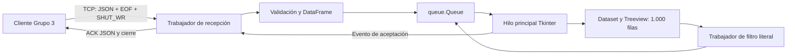

# Informe técnico del servidor — Grupo 4

## A. Introducción

El servidor oficial es `ServidorBigData`, en `servidor_prueba.py`. Recibe registros
del cliente, valida la transferencia, construye un DataFrame y permite explorar
los datos mediante filtros y páginas de 1.000 filas. El nombre del archivo es
histórico: al ejecutarlo se abre el dashboard oficial del Grupo 4.

La corrección se realizó en `jose-server-pruebas`, partiendo del commit `d692493`.
Se conservaron intactos `cliente.py`, `tests/test_cliente.py` y
`docs/informe_arquitectura.md`. No se hicieron commits, merges ni publicaciones.

## B. Responsabilidades

Grupo 3 carga el CSV, informa su calidad, permite seleccionar columnas y transmite
un arreglo JSON por lotes. Grupo 4 acepta la conexión, reconstruye y valida el
mensaje, administra su dataset en memoria, confirma el resultado y presenta el
dashboard. Los lotes del cliente no son mensajes independientes para el receptor.

Cada transferencia aceptada reemplaza el dataset anterior; no se acumulan cargas.
El servidor no exige ocho columnas ni aplica filtros durante la recepción.
Los filtros posteriores solo cambian la vista y conservan el dataset original.

## C. Arquitectura

`Tarjeta` hereda de `ttk.Frame` y reutiliza la presentación de paneles.
`ServidorBigData` hereda de `tk.Tk` y compone widgets, DataFrames, una cola,
eventos y trabajadores. Las funciones de recepción, decodificación, construcción
del DataFrame y filtrado se pueden probar sin crear una ventana.



La separación es deliberadamente pequeña: funciones independientes para lógica
comprobable y una clase de aplicación para presentación y coordinación. No se
incorporaron frameworks ni infraestructura de persistencia.

## D. Protocolo de comunicación

Se mantiene TCP, JSON codificado en UTF-8, el sufijo `<EOF>` y el cierre de
escritura del cliente mediante `shutdown(SHUT_WR)`. El servidor lee hasta ese
cierre, comprueba el sufijo y elimina exclusivamente sus últimos cinco bytes.
Una aparición de `<EOF>` dentro de una cadena se conserva.

TCP entrega un flujo de bytes: puede separar tanto el marcador como un carácter
UTF-8 entre dos `recv()`. Por ello se acumulan bytes y se decodifica al terminar.
No hay cabeceras nuevas ni confirmaciones por lote.

Éxito del dashboard oficial:

```json
{"ok": true, "filas": 569250}
```

Significa que el JSON fue validado, el DataFrame fue construido y el hilo
principal aplicó el dataset y su primera página. No significa persistencia en
disco, recepción del ACK por el cliente ni garantía de supervivencia a un cierre
del proceso. Si se pierde la conexión al responder, el cliente puede no conocer
el resultado aunque el servidor ya haya aceptado el dataset.

Rechazo, cuando aún es posible responder:

```json
{"ok": false, "filas": 0, "detalle": "Falta la marca <EOF>: el envío quedó incompleto."}
```

El lector real `EmisorTCP` conserva esta respuesta negativa. La interfaz del
cliente la muestra como respuesta inesperada en su ruta de error; se comprobó
sin modificar su código. Una desconexión abrupta puede impedir cualquier ACK.

### Compatibilidad histórica

Las pruebas anteriores dependían de `atender`, `ServidorPrueba`, `alternar`,
`boton` y `registro`. Se restauraron mediante adaptadores dentro del servidor.
`atender` reutiliza las validaciones y devuelve los registros aceptados. Su ACK
incluye el campo histórico `detalle: "Recepción correcta."`.

La ventana adaptadora `ServidorPrueba` confirma un DataFrame validado y encolado
en memoria para visualización. Conserva la semántica síncrona histórica, porque
su prueba llama al cliente desde el mismo hilo que Tkinter, sin procesar eventos
mientras espera el ACK. Su confirmación no prueba que la página ya esté dibujada.
El ejecutable oficial utiliza `ServidorBigData`, cuyo ACK sí espera la aplicación
en Tkinter. Las pruebas nuevas ejercitan expresamente ese camino oficial.

## E. Flujo de recepción

1. El hilo de escucha acepta una conexión.
2. Si existe otra transferencia activa, responde ocupado y cierra la nueva.
3. El trabajador recibe bloques de hasta 1 MiB, vigilando cancelación y plazos.
4. Tras el cierre de escritura, exige el sufijo EOF y decodifica UTF-8.
5. Verifica JSON y exige una lista cuyos elementos sean objetos.
6. Construye el DataFrame con `dtype=object`.
7. Encola la aceptación y espera su evento, con plazo limitado.
8. El hilo principal sustituye los datos y dibuja la primera página.
9. El trabajador responde según el resultado y cierra su conexión en `finally`.

Un error de aceptación restaura las referencias al dataset anterior y produce
ACK negativo. Si la aceptación vence, su callback pendiente queda cancelado y
no debe aplicar datos después del rechazo.

## F. Concurrencia

La política es **una transferencia activa**. Las adicionales se rechazan, sin
crear trabajadores ilimitados ni elegir un ganador entre cargas concurrentes.
El rechazo temprano es de mejor esfuerzo: un cliente que ya esté enviando puede
observar un error de socket antes de leerlo. Debe reintentar al quedar libre.

Los hilos de red y de filtrado no consultan ni actualizan widgets. Dejan tareas
en `queue.Queue`; Tkinter las ejecuta mediante `after(100, ...)`. Cada ciclo
procesa como máximo 50 tareas. Una excepción individual se registra y no impide
las siguientes tareas ni la programación del próximo ciclo.

Un evento solicita la detención. Las lecturas usan esperas de 0,2 segundos para
revisarlo; el `accept` revisa cada 0,5 segundos. La escucha cierra su socket y
espera al trabajador antes de habilitar el reinicio. El cierre de ventana cancela
el sondeo, espera asíncronamente a escucha, recepción y filtro, descarta tareas
pendientes y finalmente destruye los widgets.

El parseo JSON, la construcción de Pandas y una operación de filtro ya iniciada
no se interrumpen a mitad de su cálculo. El cierre espera que terminen. No hay
actualizaciones sobre widgets destruidos.

## G. Procesamiento de datos

Se rechazan JSON incompleto, codificación inválida, estructura incorrecta,
claves repetidas, constantes `NaN`/`Infinity` y números que desbordan a infinito.
Se admiten listas vacías y columnas variables. Las fechas se mantienen como
texto; no hay conversiones automáticas de fecha ni redondeo explícito.

`dtype=object` conserva enteros Python junto a `None` y evita convertir un entero
como `9007199254740993` a un flotante impreciso. Los decimales siguen la semántica
de `float` de Python, compatible con los valores emitidos por Grupo 3; no se
promete aritmética decimal exacta de precisión arbitraria.

Los objetos con distintas claves producen la unión de columnas. Una clave
ausente se representa como dato faltante de Pandas; un `null` explícito se
conserva como `None` en columnas de objetos. Para la vista, los faltantes se
muestran como `—`, sin modificar el DataFrame original.

## H. Interfaz gráfica

Se conservan Tkinter, Treeview, desplazamiento horizontal y vertical, encabezados
dinámicos y navegación anterior/siguiente. Solo se inserta el slice de hasta
1.000 registros. Al cambiar de dataset se reinicia la página y se limpia la
entrada de filtro. Un dataset vacío limpia los encabezados anteriores; un filtro
sin resultados conserva sus columnas y deshabilita ambos botones.

La búsqueda es literal, sin distinguir mayúsculas, sobre todas las columnas y
todas las filas. `regex=False` evita que `[` falle o que `.` signifique cualquier
carácter. Se combina una máscara por columna para no crear de una vez toda la
copia textual del DataFrame.

El filtro corre en un trabajador, con un máximo de un cálculo simultáneo. Una
versión identifica su origen: limpiar el filtro o aceptar otro dataset invalida
su resultado pendiente. Se comprobó que Tkinter procesa un callback mientras el
filtro está ocupado y que un resultado antiguo no reemplaza datos nuevos.

## I. Manejo de errores

Los errores de recepción no reemplazan el dataset válido anterior. Siempre se
intenta devolver un ACK negativo y se cierra la conexión. Un error al enviar el
ACK por un socket ya roto no impide liberar recursos. Los mensajes encolados
capturan el texto de la excepción, evitando el `NameError` de la variable del
bloque `except`.

La cola registra excepciones mediante `logging.exception`, con traza para
diagnóstico. El puerto ocupado se informa en la ventana. La aplicación permite
otra transferencia después de errores y reiniciar la escucha después de detener.

## J. Optimizaciones Big Data

La recepción utiliza `bytearray`, bloques de 1 MiB y límites explícitos. Durante
el procesamiento coexisten bytes, texto UTF-8, objetos JSON y DataFrame; el límite
del payload no equivale a un límite de memoria residente. Se elimina la lista
temporal de registros cuando se construye el DataFrame oficial.

La paginación limita el costo de dibujo. El filtro asíncrono evita ejecutar su
recorrido completo dentro de un callback de Tkinter; los hilos Python siguen
compartiendo el GIL, por lo que no se promete latencia constante bajo toda carga.

### Medición reproducida con datos sintéticos

Prueba aislada `test_carga_masiva_sintetica`, Windows, Python 3.13.5 y Pandas 3.0.3:

| Medida | Resultado observado |
|---|---:|
| Filas | 569.250 |
| Columnas | 8 |
| JSON, sin los cinco bytes del EOF | 89.830.391 bytes |
| Tiempo desde envío por el cliente hasta ACK | 4,378 s |
| Tiempo acumulado dentro de las llamadas de envío | 0,071 s |
| Decodificación y validación JSON | 1,323 s |
| Construcción de DataFrame | 0,297 s |
| Memoria profunda del DataFrame | 192,18 MiB |
| RSS del proceso conjunto al medir | 529,21 MiB |
| Pico RSS del proceso conjunto | 660,36 MiB |
| Filas reconstruidas | 569.250 |
| ACK | `{"ok": true, "filas": 569250}` |
| Filas dibujadas | 1.000 |
| Errores o diferencias de integridad | Ninguno |

Columnas: `id`, `fecha`, `estacion`, `zona`, `caudal`, `area`, `lon`, `nota`.
Se utilizó un identificador distinto por fila y texto Unicode que incluye `<EOF>`.
`assert_frame_equal` comparó el conjunto completo, incluidos tipos, orden y nulos.
Se transmitieron 114 lotes mediante el emisor real, sin modificarlo.

La memoria corresponde al proceso de pruebas con cliente, servidor y dataset
fuente; no es el consumo aislado del servidor. El tiempo acumulado de envío no
incluye toda la serialización, ni representa velocidad LAN. Las mediciones son
observaciones de esta máquina, no umbrales de aceptación universales.

En otra ejecución dirigida, el filtro literal `<EOF>` sobre las 569.250 filas
encontró las 569.250 coincidencias en 1,271 segundos, mantuvo el dibujo en 1.000
filas y procesó un callback de Tkinter durante el trabajo. La transferencia de esa
ejecución tardó 4,358 segundos; el pico RSS conjunto fue 661,67 MiB.

## K. Pruebas técnicas

Ejecución sin cachés persistentes:

```powershell
$env:PYTHONDONTWRITEBYTECODE='1'
python -m pytest tests/test_servidor.py -q -rs -p no:cacheprovider
python -m pytest -q -rs -p no:cacheprovider
python -m pytest tests/test_servidor.py::test_carga_masiva_sintetica -q -s -p no:cacheprovider
```

Las pruebas incluyen fragmentación byte a byte de UTF-8 y EOF; marcador dentro
de valores; JSON malformado; EOF ausente; estructura inválida; claves duplicadas;
enteros grandes con nulos; límite de bytes; inactividad y plazo total; cliente
real y ACK negativo; cancelación real; recuperación; simultaneidad; detención,
reinicio y cierre durante recepción; excepción en cola; filtros literales;
paginación; resultados obsoletos de filtros y carga sintética completa.

La fragmentación se fuerza con un receptor determinista porque TCP no conserva
los límites de los `send`. La integración utiliza además sockets reales en
localhost con puertos efímeros y ventanas Tkinter ocultas.

Las pruebas históricas usaban interfaces eliminadas: fixture `servidor` y prueba
de EOF dependen de `atender`; las cuatro pruebas del interruptor y registro
dependen de `ServidorPrueba`. Los adaptadores restauran esas APIs sin modificar
las pruebas del Grupo 3. Las pruebas nuevas validan el servidor oficial aparte.

Validación específica final: **25 aprobadas y 1 omitida**, en 16,25 segundos. La
omisión corresponde exclusivamente al CSV real ausente.

Suite completa final: **54 aprobadas y 2 omitidas**, en 24,70 segundos, sin fallos,
errores ni advertencias reportadas por pytest. Ambas omisiones corresponden al
CSV real ausente, una en cada módulo de pruebas. Los ocho casos que inicialmente
fallaban o daban error por APIs históricas ausentes quedaron superados.

En una ejecución intermedia se observó un error de inicialización de la instalación
de Tkinter: no pudo leer `icons.tcl`, aunque se comprobó que el archivo existía.
No se ocultó como prueba aprobada ni se modificó la instalación. El caso afectado
y la ejecución específica completa pasaron al repetirlos. Las pruebas nuevas
solo omiten una GUI cuando el error indica ausencia de pantalla; otros errores
de inicialización se propagan.

Limitaciones: no se dispone del CSV CAMELS real ni del PDF de propuesta. El caso
real se omite expresamente cuando falta el archivo. No se midió rendimiento entre
dos equipos LAN ni resistencia frente a agotamiento deliberado de recursos. Las
pruebas de timeout reducen los plazos mediante configuración temporal; no esperan
60 segundos por caso.

## L. Configuración y despliegue

Dependencias: Python con Tkinter, Pandas y pytest para pruebas. El repositorio
no fija versiones; el entorno utilizado se indica arriba. En Windows:

```powershell
python -m pip install pandas pytest
python servidor_prueba.py
```

Pulsar **Iniciar escucha** antes de enviar desde `python cliente.py` en otra
terminal. IP y puerto también se pueden editar en la interfaz.

| Variable de entorno | Predeterminado | Uso |
|---|---:|---|
| `SERVIDOR_HOST` | `127.0.0.1` | Dirección local de escucha |
| `SERVIDOR_PUERTO` | `12345` | Puerto TCP |
| `SERVIDOR_MAX_BYTES` | `536870912` | Payload máximo incluyendo EOF |
| `SERVIDOR_TIMEOUT` | `60` | Inactividad y espera de aceptación, segundos |
| `SERVIDOR_TIEMPO_TOTAL` | `600` | Duración máxima de recepción, segundos |

Usar valores numéricos positivos. El límite predeterminado supera el JSON
sintético probado; el CSV real deberá verificarse cuando esté disponible.

`127.0.0.1` sirve para cliente y servidor en el mismo equipo. En LAN, escuchar en
la IP local del servidor o `0.0.0.0`; el cliente debe apuntar a la IP real del
servidor, y Windows debe permitir el puerto en la red correspondiente. No usar
`0.0.0.0` como destino del cliente. El protocolo actual no incorpora autenticación
ni cifrado; su alcance es académico en una red controlada.

## M. Defensa académica

TCP aporta orden y retransmisión; la aplicación aporta delimitación y validación.
`sendall()` no garantiza que un `recv()` entregue un lote completo. El cierre de
escritura marca el final del flujo enviado y conserva el canal inverso para ACK.
El sufijo EOF permite distinguir una transferencia válida de un cierre prematuro.

`threading` permite esperar red sin bloquear el bucle gráfico. `queue` traslada
trabajo al hilo propietario de los widgets. Los eventos comunican cancelación y
aceptación; el pequeño candado de decisión impide aplicar una aceptación que ya
fue cancelada mientras otro hilo esperaba. Pandas representa el dataset completo;
Treeview muestra únicamente la página necesaria.

La orientación a objetos se demuestra con herencia de widgets y de la ventana
adaptadora, composición de componentes y encapsulación de operaciones en métodos.
La reutilización del receptor evita mantener protocolos distintos entre APIs.

Demostración sugerida: enviar columnas seleccionadas; mostrar nulos y texto con
EOF; navegar al final; buscar `[` literalmente; cancelar una carga; reenviar una
válida; detener/reiniciar; ejecutar pytest y mostrar la comparación integral de
569.250 filas sintéticas. Para afirmar cumplimiento con CAMELS, repetir con el
CSV real y conservar esa evidencia.

## N. Historial de correcciones

| Defecto auditado | Corrección | Evidencia automatizada |
|---|---|---|
| UTF-8 y EOF fragmentados | Bytes hasta SHUT_WR, decodificación final | `test_fragmentacion_y_datos` |
| EOF dentro de valores eliminado | Retirar únicamente el sufijo | Fragmentación y cliente real |
| JSON completo sin EOF aceptado | Terminador obligatorio | Rechazos y ACK negativo |
| Estructuras incorrectas aceptadas | Lista de objetos, claves únicas | `test_rechazos` |
| Entero grande convertido a float | DataFrame con objetos | Fragmentación e integridad real |
| Excepción capturada por lambda | Captura de mensaje como argumento | Recuperación tras recepción fallida |
| Cola detenida por un callback | Captura por tarea y sondeo en finally | `test_cola_resiste_excepcion` |
| ACK positivo anterior al dashboard | Evento tras aplicación oficial | Cliente real y rechazo del dashboard |
| Regex accidental | `regex=False` | Paginación y filtros literales |
| Filtro dentro del hilo gráfico | Trabajador y versión de resultado | Filtro asíncrono con latido Tk |
| Botones y encabezados obsoletos | Reinicio al quedar vacío o cambiar carga | Paginación y dataset vacío |
| Conexiones ilimitadas | Un trabajador de transferencia | Simultáneas y reinicio |
| Recepción sin límites | Bytes máximos, inactividad y plazo total | Límite y timeouts reales |
| Trabajadores tras cierre de ventana | Espera asíncrona antes de destruir | Cierre con recepción activa |
| APIs históricas ausentes | Adaptadores en módulo servidor | Suite existente sin editar |

La documentación del Grupo 3 permanece intacta y describe una versión histórica.
Este informe identifica la implementación y garantías actuales del Grupo 4.


