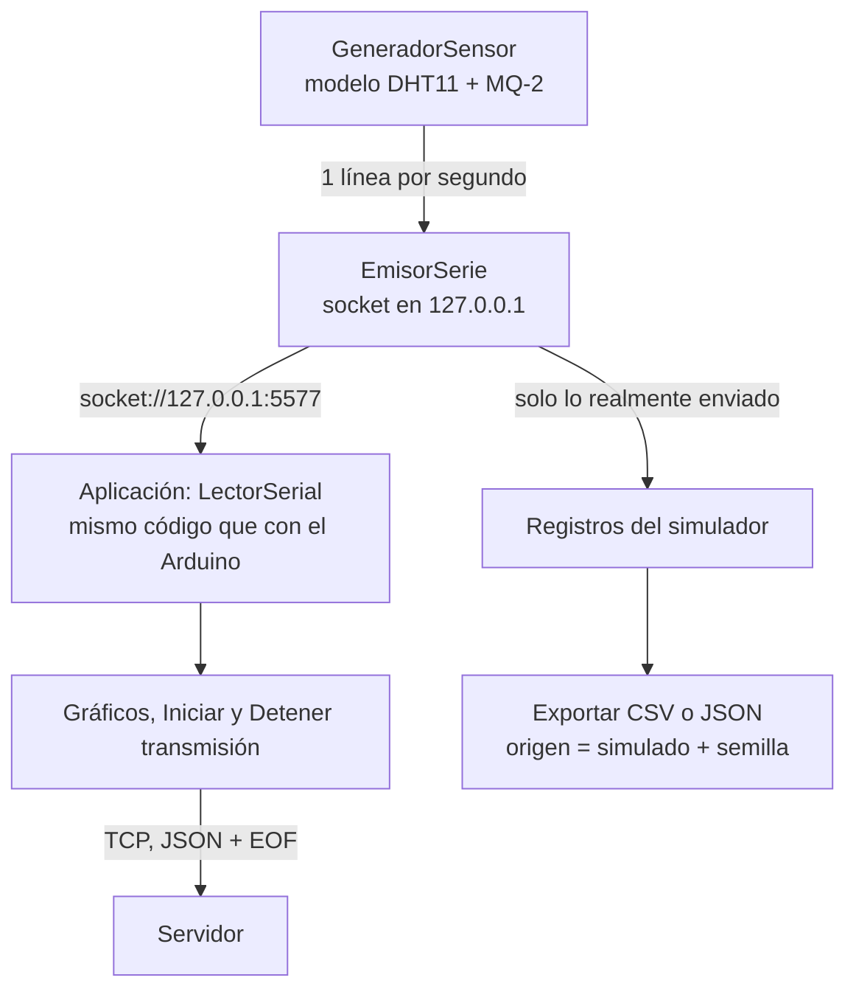

# Simulador de Arduino (solo pruebas)

`simulador_arduino.py` reemplaza a la placa cuando no se tiene a mano. Abre una ventana
aparte que "enciende" un Arduino virtual y envía a la aplicación las mismas líneas que
enviaría el script `scrip_arduino_sensor_v3.txt`: `temperatura,humedad,gas`, una por segundo.

> **Los datos son sintéticos.** Modelan un DHT11 y un MQ-2, pero no son mediciones.
> Todo lo que exporta lleva `origen = simulado` y la semilla usada, para que quien los
> analice sepa de dónde vienen y pueda reproducirlos.

## Cómo usarlo

1. Abrir el simulador: `python simulador_arduino.py` y pulsar **Encender Arduino**.
2. Abrir la aplicación: `python cliente.py` → pestaña **Sensor Arduino**.
3. En la lista de puertos elegir `socket://127.0.0.1:5577` (aparece siempre al final) y
   pulsar **Conectar Arduino**.
4. Seguir como con la placa real: Iniciar transmisión → Detener transmisión.

El puerto se puede cambiar en la ventana del simulador; en ese caso se define también
`SIMULADOR_PUERTO` antes de abrir la aplicación, para que la lista muestre el mismo.

## Por qué un socket y no un puerto COM virtual

`pyserial` abre direcciones `socket://host:puerto` igual que un `COM3`. Así la aplicación
usa **exactamente el mismo código** que con el Arduino real (`LectorSerial`), sin instalar
drivers de puertos virtuales (com0com en Windows, socat en Linux) y con el mismo
comportamiento en ambos sistemas. El simulador escucha solo en `127.0.0.1`: no queda
expuesto a la red.



## Qué tan fidedignos son los datos

| Magnitud | Modelo | Rango |
|---|---|---|
| Temperatura | oscilación lenta (10 min) + deriva + ruido; **resolución de 1 °C** como el DHT11 azul | 0 a 50 °C |
| Humedad | baja cuando sube la temperatura + oscilación + ruido; **resolución de 1 %** | 20 a 90 % |
| Gas (MQ-2) | base ~140 + ruido de ±2,5; **precalentamiento** alto que decae en ~20 s al encender | 0 a 1023 |
| Fallos | ~1 % de las lecturas del DHT11 salen como `ERROR_LECTURA` | — |

- **Evento de gas:** el botón "Simular evento de gas" suma +400 al valor, que decae solo
  en cerca de un minuto. Sirve para ver cómo reacciona el gráfico.
- **Semilla:** con la misma semilla la secuencia es idéntica. Si se deja vacía se elige una
  al azar y queda registrada en la exportación.
- **DHT11 entero:** el sensor azul entrega enteros (el sketch los imprime como `23.0`).
  Desmarcar la casilla da un decimal, como un DHT22.
- Las líneas terminan en `\r\n`, igual que `Serial.println()`.

Los parámetros del modelo (rangos, amplitudes, ruido) son **supuestos razonables**, no
están calibrados con mediciones de la placa del laboratorio.

## Exportar lo enviado

Los botones **Exportar CSV** y **Exportar JSON** guardan **solo lo que se envió a la
aplicación** (si nadie estaba conectado, esa línea no se registra). Cada archivo incluye
también las lecturas fallidas, para reflejar fielmente lo emitido.

**CSV** (`fecha_hora, temperatura, humedad, gas, estado, origen`):

```csv
fecha_hora,temperatura,humedad,gas,estado,origen
2026-11-23 15:38:36.512,22.0,57.0,398,OK,simulado
2026-11-23 15:38:37.513,,,,ERROR_LECTURA,simulado
```

**JSON** (metadatos + registros; los fallos llevan `null`):

```json
{
  "origen": "simulado",
  "generador": "simulador_arduino.py",
  "aviso": "Datos sintéticos que modelan un DHT11 y un MQ-2; no son mediciones reales.",
  "semilla": 2026,
  "frecuencia_s": 1.0,
  "resolucion_dht11": "entera",
  "puerto_local": 5577,
  "resumen": { "registros": 120, "errores_lectura": 1,
               "inicio": "2026-11-23 15:38:36.512", "fin": "2026-11-23 15:40:35.514" },
  "registros": [ { "fecha_hora": "2026-11-23 15:38:36.512", "temperatura": 22.0,
                   "humedad": 57.0, "gas": 398, "estado": "OK", "origen": "simulado" } ]
}
```

### Cómo se relaciona con lo que recibe el servidor

- El simulador exporta **todas** las líneas enviadas (1 por segundo). La aplicación guarda
  una fila cada 1, 2 o 3 s según la frecuencia elegida, así que el servidor recibe un
  subconjunto. Con "1 dato por segundo" las filas coinciden salvo las `ERROR_LECTURA`.
- La aplicación pone su propia `fecha_hora` al muestrear, por lo que puede diferir del
  simulador en unos milisegundos.
- **Lo que llega al servidor no lleva la marca `origen`.** Las filas de la aplicación tienen
  `fecha_hora, temperatura, humedad, gas`. Si el equipo de servidor va a analizar esos datos,
  hay que avisarles que son simulados (o agregar una columna `origen` en la aplicación).

## Pruebas

`tests/test_simulador.py` (15 pruebas, sin Arduino) cubre: reproducibilidad por semilla,
rango y resolución del DHT11, precalentamiento y evento de gas, exportación CSV/JSON,
lectura real por `socket://` con `pyserial`, línea partida a mitad de camino, desconexión,
y el recorrido completo simulador → aplicación → servidor comprobando que el servidor
recibe exactamente lo emitido.
